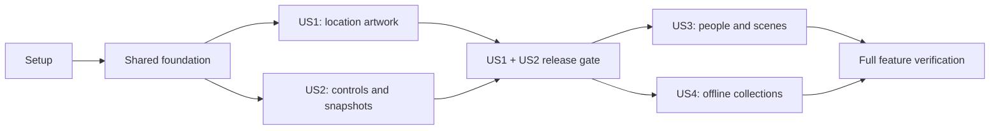

# Tasks: Adventure Artwork

**Input**: [spec.md](spec.md), [plan.md](plan.md), [research.md](research.md), [data-model.md](data-model.md), [contracts/artwork.md](contracts/artwork.md), [quickstart.md](quickstart.md).  
**Branch**: `181-adventure-artwork`  
**Tests**: Required before implementation; demonstrate failure first, then cover success and a meaningful negative/cancellation path.  
**Organisation**: Four user stories; the first public release requires US1 + US2 together. Completing US1 alone permits an internal demonstration only. No application implementation or asset creation is performed by generating this list.

## Phase 1: Setup

- [x] T001 Inspect actual branch seams with `bunx fallow guard` and record >500-line responsibilities/extraction targets for `packages/adventure-engine/src/schemas.ts`, `packages/adventure-engine/src/types.ts`, `apps/web/src/lib/components/oracle/adventure/AdventureSurface.svelte` and cloud/schema/Vault entrypoints in `specs/181-adventure-artwork/research.md`; preserve unrelated work and existing tests.
- [x] T002 Scaffold `packages/adventure-artwork-engine/package.json`, `packages/adventure-artwork-engine/tsconfig.json` and `packages/adventure-artwork-engine/src/index.ts`, with existing workspace/Zod dependencies and no new third-party dependency; wire only affected workspace resolution in `apps/web/package.json`, `packages/adventure-engine/package.json` and `bun.lock`.
- [x] T003 Add synthetic fixtures for visible/hidden scenes, same-name people, canonical/local images and corrupt assets in `packages/adventure-artwork-engine/tests/fixtures.ts` and `apps/web/src/lib/services/adventure/artwork/__fixtures__/artwork.ts`; no real private data or committed bitmaps. This fixture-authoring task is a prerequisite for tests that import these fixtures, not parallel with their consumers.

## Phase 2: Foundation — shared contracts

**Blocks every user story.** Pure policy tests precede library implementation; browser IO stays injected.

- [ ] T004 [P] Write failing persisted-shape tests in `packages/schema/src/adventure-artwork.test.ts`: optional automatic/override, `version:1`, `dismissed | catalogue | snapshot`, safe local snapshot paths, bounded IDs, unknown-version preservation, missing fields and duplicate local subject keys; fixture `AdventureSession.artwork` is optional and limited to 200 local associations.
- [ ] T005 Implement shared schemas in `packages/schema/src/adventure-artwork.ts` and export via `packages/schema/src/index.ts`; keep `automatic` and `override` optional, require snapshot MIME/bytes/dimensions/SHA-256, reject mutable/remote snapshot paths, and preserve opaque future extensions without making ordinary entities unreadable.
- [ ] T006 [P] Write failing invalid-input/ingestion tests in `packages/adventure-artwork-engine/tests/catalogue.test.ts` and `scripts/validate-adventure-artwork.test.ts`: duplicate IDs, stock origin, absent approval/model/distribution evidence, unsupported cues/types/genre, URL credentials/query/fragment, unsafe host/path, invalid dimensions/hash and catalogue byte limits.
- [ ] T007 Implement catalogue schemas and ingestion in `packages/adventure-artwork-engine/src/catalogue.ts` and `scripts/validate-adventure-artwork.mjs`: `id` is “max 100 characters, globally unique”; `version` is a “positive integer”; `type` is `location | npc | scene | atmosphere`; `genres` is “nonempty controlled IDs”; cues have “At most 24 cues total per asset”; `alt` is “1–240 characters”; crop is “finite x/y from 0 to 1”; origin is `team-generated-ai` with mandatory tool/model/date/public-safe provenance, human approval and distribution evidence; visual-content changes require a new asset ID while metadata versions cannot repoint old pictures; immutable WebP variants use only `https://assets.codexcryptica.com/adventure-artwork/`; catalogue ≤256 KiB uncompressed at 200 assets, landscapes ≤1280 × 720/384 KiB, portraits ≤768 × 1024/256 KiB, previews ≤320 px/32 KiB. Provide a no-argument release gate that validates the assembled catalogue against a checked-in last-released manifest (an explicitly recorded empty baseline for the first release), failing closed if either input is unavailable; keep explicit file arguments for isolated transition tests.
- [ ] T008 [P] Write failing policy tests in `packages/adventure-artwork-engine/tests/matching.test.ts` and `packages/adventure-artwork-engine/tests/selection.test.ts` covering score ties, incompatible/unknown genres, no primary cue, hidden-input exclusion, withdrawal, all precedence states, immutable kept-catalogue content across metadata updates/new visual asset IDs, and override/automatic preservation.
- [ ] T009 Implement `packages/adventure-artwork-engine/src/cues.ts`, `matching.ts`, `selection.ts` and `associations.ts`: filter eligibility/contradictions first; primary 8/context 4/mood/time 1; threshold 8 AND primary match; ascending asset-ID ties; Workspace/unknown neutral-only; precedence is disabled/dismissed → explicit → available Vault image → saved automatic → new match → none; missing explicit source never silently falls back.
- [ ] T010 Define constructor-injected IO/control/storage ports and production assembly boundaries in `apps/web/src/lib/services/adventure/artwork/ports.ts`, including narrow mutation results `{ok:true}|{ok:false}`, revision/lease context, snapshot writer, managed object-URL release, abortable fetch, digest, lock and device index adapters; do not add a second canonical store.

## Phase 3: US1 — recognise places without interrupting play (P1)

**Goal**: Stable location art with Vault precedence and text-only failure behaviour.  
**Independent test**: Visit → five ordinary turns → leave → reload → return, with Vault art, catalogue art and no-match cases. This is not a public release until US2 is complete.

### Tests first

- [ ] T011 [P] [US1] Write failing cache tests in `apps/web/src/lib/services/adventure/artwork/artwork-cache.test.ts`: validated offline hit, wrong MIME/hash/bytes/dimensions, HTML/SVG/opaque response, unsafe redirect, oversize stream, timeout, subscriber cancellation, quota failure, unavailable cache and two-consumer deduplication.
- [ ] T012 [P] [US1] Write failing persistence/commit tests in `apps/web/src/lib/stores/oracle/tests/adventure-artwork.test.ts` and `apps/web/src/lib/services/adventure/artwork/artwork-repository.test.ts`: committed-only assignment, five-turn no-churn, failed revision/save, lease loss, canonical write-once across adventures, and malformed/unknown artwork preserved without failing narrative or erasing data.
- [ ] T013 [P] [US1] Write failing component tests in `apps/web/src/lib/components/oracle/adventure/artwork/AdventureSceneArtwork.test.ts`: one modest landscape, fixed dimensions, credits/AI label, loading/error/no-match, no transcript repetition, no focus/scroll/draft changes and stale load after subject switch.
- [ ] T014 [P] [US1] Write failing adapter tests in `apps/web/src/lib/services/adventure/artwork/artwork-resolver.test.ts`: player-visible-only cues, genre mapping, no image-selection AI request, no narrative/Vault IDs in request/referrer/telemetry, missing Vault image fallback and withdrawn cached asset suppression.

### Implementation

- [ ] T015 [US1] Integrate optional `Entity.adventureArtwork` and session artwork via `packages/schema/src/entity.ts`, `packages/adventure-engine/src/artwork-state.ts`, `types.ts` and `schemas.ts`; maintain old `schemaVersion:3` readability, independently quarantine malformed optional artwork and retain unknown versions/recovery references; enforce 200 local associations without truncating narrative.
- [ ] T016 [US1] Implement `apps/web/src/lib/services/adventure/artwork/artwork-repository.ts`: session saves use current lease/revision; canonical changes re-read narrow state under a shared Vault/entity lock and existing partial-update queue; unavailable exclusion fails retryably; never overwrite unrelated entity fields or committed turns.
- [ ] T017 [US1] Implement visible-subject resolution and lazy catalogue access in `apps/web/src/lib/services/adventure/artwork/artwork-resolver.ts` and `catalogue-service.ts`, reusing `apps/web/src/lib/services/adventure/world-style.ts`; query/scene inputs are capped at 24 controlled cue IDs of 1–64 characters with unknown/duplicate entries discarded, no full hidden session object enters matching and no name-only identity is invented.
- [ ] T018 [US1] Implement public-cache core in `apps/web/src/lib/services/adventure/artwork/artwork-cache.ts` and `cache-index.ts`: namespace `codex-adventure-artwork-v1`, device key `codex-adventure-artwork-cache:v1`, 32 MiB automatic LRU, two fetches, eight-second timeout, actual byte/hash/decode checks, omitted credentials/no-referrer, subscriber abort semantics, crash reconciliation and object-URL disposal; cache index stores no private subject fields.
- [ ] T019 [US1] Add `apps/web/src/lib/stores/oracle/adventure-artwork.svelte.ts` and narrowly compose it through `adventure-dependencies.ts`, `adventure-runtime.ts` and `adventure-manager.svelte.ts`: pure local assignment joins successful session commit, canonical automatic write is best-effort after commit, network never blocks narrative, and every asynchronous completion checks Vault/session/subject currency.
- [ ] T020 [US1] Implement `apps/web/src/lib/components/oracle/adventure/artwork/AdventureSceneArtwork.svelte` and mount in `AdventureFocusPlay.svelte`; use Svelte 5, semantic tokens/Iconify, reserved landscape space, lazy offscreen loading and no large repeated transcript image blocks.
- [ ] T021 [US1] Create, human-review and upload 24 team-generated landscape assets across fantasy/contemporary/science-fiction/horror with neutral candidates, following the imagegen skill during actual asset work; record only metadata in `packages/adventure-artwork-engine/src/catalogue/seed.ts` and `index.ts`, validate approved provenance/size/hash, upload variants to R2 and delete temporary local bitmaps immediately after upload.
- [ ] T022 [US1] Add basic location/illustrative-versus-canonical/credits Help in `apps/web/src/lib/content/help/adventure-artwork.md`, link from `adventure-mode.md` and register through `packages/help-engine/src/registry/features/lore-oracle.ts` and its existing index; explain no-match, AI-disabled matching and offline limits without claiming later slices.
- [ ] T023 [US1] Validate US1 with targeted tests, the 200-asset matching fixture and `apps/web/tests/adventure-artwork.spec.ts` location cases; record command/results in `specs/181-adventure-artwork/quickstart.md`; keep the feature unexposed publicly until T040.

## Phase 4: US2 — control and preserve artwork (P1)

**Goal**: Keep exact pictures, replace/dismiss/restore/disable, safe owner backup and no guest leakage.  
**Independent test**: With location fixtures only, Keep → replace/delete original → reload → ZIP/cloud restore, plus cancel/failure/dismiss/disable and actual guest media inspection.

### Tests first

- [ ] T024 [P] [US2] Write failing immutable-picture tests in `apps/web/src/lib/services/adventure/artwork/snapshot-service.test.ts`: exact bytes despite original deletion, 16 MiB/32-megapixel boundaries, unsupported formats, write/verify failure, cancel before save, rollback and shared-reference cleanup protection.
- [ ] T025 [P] [US2] Write failing command tests in `apps/web/src/lib/services/adventure/artwork/artwork-commands.test.ts`: Keep/Replace/Dismiss/Restore transitions, unavailable explicit source, save resolving `{ok:false}`, lease loss during copy, concurrent entity changes and device-setting persistence/default/storage failures.
- [ ] T026 [P] [US2] Write failing owner round-trip/media tests in `apps/web/src/lib/services/cloud-backup-roundtrip.test.ts`, `cloud-backup-payload.test.ts` and `apps/web/src/lib/utils/vault-archive.test.ts`: snapshot digest preserved, active/archived/recovery adventure documents, safe paths, full adventure push, entity-only delta retention and reference pruning.
- [ ] T027 [P] [US2] Write failing guest safety tests in `packages/vault-engine/src/services/GuestExporter.test.ts` and `apps/web/src/lib/services/adventure/artwork/artwork-guest-export.test.ts`: sanitised metadata AND `apps/web/src/lib/services/publishing/PublishingService.svelte.ts` publishing/export media lists exclude private snapshot bytes/paths, adventure documents and `adventureArtwork`.
- [ ] T028 [P] [US2] Write failing keyboard/focus/cancel/read-only/disabled-request tests in `apps/web/src/lib/components/oracle/adventure/artwork/ArtworkChooser.test.ts` and `ArtworkSettings.test.ts`, including in-flight disable and successful re-enable without losing choices.
- [ ] T029 [US2] Implement byte-preserving snapshot IO in `apps/web/src/lib/services/adventure/artwork/snapshot-service.ts` and a focused `packages/vault-engine/src/artwork-snapshots.ts` adapter: unique private `images/artwork_<opaque-id>.<validated-extension>`, PNG/JPEG/WebP only with MIME/signature/decode agreement and positive integer dimensions/bytes ≤16 MiB/32 megapixels, source digest verification and optional derivative thumbnail; never use a mutable entity path, R2 upload, lossy original conversion or disposable cache.
- [ ] T030 [US2] Implement `apps/web/src/lib/services/adventure/artwork/artwork-commands.ts` and integrate repository mutations: preserve/verify before override save, report success only after durable writes, clean only newly unreferenced snapshots on failure, retain automatic history, and Restore automatic clears explicit state without editing `Entity.image`.
- [ ] T031 [US2] Add injected visibility/preference handling in `apps/web/src/lib/services/adventure/artwork/artwork-preferences.ts` and the artwork manager: device key `codex-adventure-artwork-enabled`, default true, abort automatic consumers/revoke URLs while disabled, preserve selections, and separate explicit download purpose from automatic image requests.
- [ ] T032 [US2] Implement `ArtworkChooser.svelte` and `ArtworkSettings.svelte` in `apps/web/src/lib/components/oracle/adventure/artwork/`; mount plain Keep/Choose another/Dismiss/Restore automatic/visibility and cache-removal controls through the existing Adventure tools/settings composition, with focused progress/retry/cancel and no action-draft loss.
- [ ] T033 [P] [US2] Write failing inclusion-consent/revocation tests in `apps/web/src/lib/stores/cloud-backup-artwork-consent.test.ts` and `apps/web/src/lib/stores/cloud-backup-dirty.test.ts`: `includeAdventures` default false for old/new backups, no pre-consent adventure read/upload OR canonical artwork fields/snapshot bytes in full/entity-delta/media projections, source records unchanged by projection, failed revocation retry, last-good-backup retention and unchanged local data.
- [ ] T034 [US2] Implement explicit inclusion consent in `apps/web/src/lib/stores/cloud-backup-artwork-consent.ts` and `apps/web/src/lib/components/settings/CloudBackupSettings.svelte`: disclose transcripts/GM notes/private kept images, Cloudflare/provider and actual support access, enable only after acceptance, preserve existing consented ordinary entity-image scopes while gating canonical artwork metadata/snapshot references too, and expose disable/remove-existing-remote-inclusion controls.
- [ ] T035 [US2] Add focused reference/collection adapter `apps/web/src/lib/services/cloud-backup-artwork.ts`; integrate optional `adventures` and snapshot enumeration into `cloud-backup-payload.ts`, existing media eligibility and current live-reference/pruning sets; safe paths only, canonical/private snapshot scope distinguished and all new artwork fields/bytes gated by inclusion on full/entity-delta/media paths, no unsupported Worker adventures delta.
- [ ] T036 [US2] Wire durable adventure writes/deletions/consent changes to existing full-push dirty signalling through `adventure-session-repository.ts` and cloud lifecycle; extend `apps/web/src/lib/stores/cloud-backup-restore.ts` to restore optional adventures/assets, preserve older backups, and remove disabled remote-only references without deleting retained entity media or local files.
- [ ] T037 [US2] Complete owner archive/guest integration in `apps/web/src/lib/utils/vault-archive.ts`, `packages/vault-engine/src/services/GuestExporter.ts` and `apps/web/src/lib/services/publishing/PublishingService.svelte.ts` public media enumeration; strip owner artwork metadata, include private snapshots only in owner archives and refuse unsafe paths or arbitrary referenced uploads.
- [ ] T038 [US2] Implement conservative snapshot reference/cleanup in `apps/web/src/lib/services/adventure/artwork/snapshot-references.ts` with co-located tests: scan entities, all adventures and pending links; unknown/recovery shapes prevent aggressive deletion; deleting one owner never deletes another's picture and public LRU never touches `images/`.
- [ ] T039 [US2] Expand `apps/web/src/lib/content/help/adventure-artwork.md` and `cloud-backup.md` for all controls, exact Keep versus automatic mode, preserved private bytes, storage scope, off-by-default cloud inclusion and disable/delete controls; evaluate an optional first-use hint without obscuring play.
- [ ] T040 [US2] Execute slice-1 release gate using `apps/web/tests/adventure-artwork.spec.ts` and `specs/181-adventure-artwork/quickstart.md`: 390 × 844/1440 × 900 in Ancient Parchment/Sci-Fi Terminal/Workspace and applicable light/dark variants, disabled-network trace, exact owner ZIP/cloud restore, guest actual asset manifest, lint/impacted tests/scoped types/catalogue gate/Fallow/codex-review; only then expose US1 + US2 publicly.

## Phase 5: US3 — recognise returning NPCs and explicit scenes (P2)

**Goal**: Portrait identity survives reappearance and canon promotion; explicit within-place scenes can own stable art.  
**Independent test**: Same-name NPCs → establish aliases → leave/reload/return → exact canonical promotion, with explicit-choice conflicts, hidden characters and invalid model IDs.

- [ ] T041 [P] [US3] Write failing identity/scene tests in `packages/adventure-engine/tests/people.test.ts` and `scene-identities.test.ts`: removal from activeCharacters, established aliases, duplicate names, explicit visible fact/record IDs, hidden facts, unknown IDs, missing fields, malformed scene/current-place links and capacity without narrative truncation.
- [ ] T042 [P] [US3] Write failing interrupted/conflicting promotion tests in `apps/web/src/lib/services/adventure/artwork/artwork-promotion.test.ts` and extend `adventure-provisional-fact-creator.test.ts`: exact identity not title, canonical explicit-over-automatic, explicit-versus-explicit owner choice, retry after either write fails, no duplicate entity/image overwrite and cross-session switch.
- [ ] T043 [P] [US3] Write failing portrait/scene display tests in `apps/web/src/lib/components/oracle/adventure/artwork/AdventureNpcPortrait.test.ts` and browser cases in `apps/web/tests/adventure-artwork-people.spec.ts`: returning identity, no hidden-trait alt/choices, modest layout, no ordinary-turn portrait churn and independent same-name people.
- [ ] T044 [US3] Add focused `people-types.ts`, `people.ts`, `scene-types.ts` and `scene-identities.ts` under `packages/adventure-engine/src/`, integrate optional schemas via `types.ts`/`schemas.ts`: “200 people/session, 8 aliases/person, 120 characters/name, 32 linked fact IDs/person”; person facts require `kind:'person'` and `visibility:'player-visible'`; optional sourceRecordId; scenes require current place/introducing committed turn, optional end turn, “200 scenes/session”; no bare-name merge, hidden registration or mood-only scene allocation.
- [ ] T045 [US3] Implement registry resolution and commit transitions in `packages/adventure-engine/src/people.ts` and `scene-identities.ts` with safe state-machine composition: exact canonical/provisional/person IDs establish identity; active fact removal does not delete a person; unknown/ambiguous/capacity cases yield no new portrait/scene and never reject valid narrative.
- [ ] T046 [US3] Extend the existing normal GM prompt/response contracts through `packages/adventure-engine/src/prompt.ts`, `schemas.ts`, `packages/ai-engine/src/adventure-response-schema.ts` and `adventure-generation.types.ts`; pass only existing player-visible people/scene identity references, add no extra AI call, and first add failing malformed/oversize optional-reference tests in `packages/ai-engine/src/adventure-response-schema.test.ts` and `adventure-turn-generation.service.test.ts` before adapting validators or the app resolver.
- [ ] T047 [US3] Implement `apps/web/src/lib/services/adventure/artwork/artwork-promotion.ts` and exact identity-link command; compose through `adventure-provisional-fact-creator.ts`, the artwork manager and `AdventureSurface.svelte`; journal pending links, preserve local recovery data until both writes complete, require explicit identity/choice on ambiguity, and never inherit title-only findExistingId as proof of person identity.
- [ ] T048 [US3] Implement `AdventureNpcPortrait.svelte` and bounded scene-subject selection in the existing artwork component/resolver, displaying current-subject art only; preserve location fallback when a committed scene has no suitable asset and retain kept images across canonical links.
- [ ] T049 [US3] Curate/upload reviewed portrait and scene metadata/variants in `packages/adventure-artwork-engine/src/catalogue/portraits.ts` and `scenes.ts`; retain generated-only provenance, ≤768 × 1024/256 KiB portraits and global catalogue budget; record coverage honestly and never commit generated bitmap files.
- [ ] T050 [US3] Update `apps/web/src/lib/content/help/adventure-artwork.md` and `adventure-mode.md` for persistent NPC identity, reuse, same-name ambiguity, canon linking/conflict choices, and explicitly illustrative scenes; do not promise every person a unique stock face.
- [ ] T051 [US3] Run slice-2 quickstart cases and focused schema/turn/promotion/browser/export tests; record evidence in `specs/181-adventure-artwork/quickstart.md`, recheck snapshot/canonical round trips, and run required scoped gates before exposing portraits/scenes.
- [ ] T066 [US3] Add tests and implement atmosphere artwork as an eligible fallback owned by an explicitly identified committed scene, after scene-specific matching and before location fallback. Mood or time changes alone never create or reassign a scene; unresolved, hidden or contradictory cues produce no atmosphere selection. Add human-reviewed atmosphere assets and provenance, or document unavailable coverage as text-only; do not claim atmosphere delivery without a reviewed eligible asset.

## Phase 6: US4 — optional offline collections (P3)

**Goal**: Explicit download, accurate progress/offline status, finite storage and reversible pack removal.  
**Independent test**: Install → cancel → resume → offline → overlapping pack removal → quota/index interruption, retaining assignments and local pictures.

- [ ] T052 [P] [US4] Write failing collection contract tests in `packages/adventure-artwork-engine/tests/collections.test.ts` and app lifecycle tests in `apps/web/src/lib/services/adventure/artwork/collection-downloads.test.ts`: unknown/duplicate assets, manifest digest, unique-byte totals, incomplete status, caller cancellation, resume and storage unavailability.
- [ ] T053 [P] [US4] Write failing policy/index tests in `packages/adventure-artwork-engine/tests/cache-policy.test.ts` and `apps/web/src/lib/services/adventure/artwork/cache-index.test.ts`: automatic ≤32 MiB, each collection ≤100 MiB, combined ≤256 MiB, shared files counted once, protected installed membership, removal suppression and index/cache crash reconciliation.
- [ ] T054 [P] [US4] Write failing collection UI tests in `apps/web/src/lib/components/oracle/adventure/artwork/ArtworkCollections.test.ts` and targeted browser cases in `apps/web/tests/adventure-artwork-collections.spec.ts`: size/credits confirmation, progress/cancel/retry/remove, no involuntary installed-pack eviction, offline claims based on actual validated files and text-only fallback.
- [ ] T055 [US4] Implement collection metadata and policy in `packages/adventure-artwork-engine/src/collections.ts`, `cache-policy.ts` and catalogue indices: versioned unique asset/variant lists, declared bytes/digest/credits, per-pack/total caps above, preflight exact missing bytes and explicit over-capacity refusal.
- [ ] T056 [US4] Implement `apps/web/src/lib/services/adventure/artwork/collection-downloads.ts`: use validated existing cache service, at most two eight-second abortable fetches, completed-subset retention, explicit missing-file retry, and no partial/opaque blob installation or unbounded automatic retry.
- [ ] T057 [US4] Extend `artwork-cache.ts` and `cache-index.ts` for reference-counted collection membership, explicit removed-ID suppression/re-enable, shared-file retention, real-cache reconciliation and namespace survival; add a focused regression to `apps/web/src/lib/service-worker/lifecycle.test.ts` proving `codex-adventure-artwork-v1` survives shell cache cleanup.
- [ ] T058 [US4] Implement `apps/web/src/lib/components/oracle/adventure/artwork/ArtworkCollections.svelte` and mount through `ArtworkSettings.svelte`: disclose sizes/coverage/credits, progress/cancel/retry/remove, distinguish explicit downloads from disabled automatic rendering and show private snapshot storage separately from disposable public cache.
- [ ] T059 [US4] Update `apps/web/src/lib/content/help/adventure-artwork.md` for collection installation/removal, offline validation, finite budgets, cancellation, browser eviction and Keep pinning catalogue identity rather than guaranteeing offline bytes.
- [ ] T060 [US4] Execute slice-3 offline/storage/collection quickstart cases and impacted tests in `specs/181-adventure-artwork/quickstart.md`, including shared assets, browser cache eviction, suppression and disabled automatic loads; run scoped gates before advertising downloadable collections.

## Phase 7: Cross-cutting verification and handoff

- [ ] T061 Audit all FR-001–FR-023 and SC-001–SC-009 against implemented task/test evidence in `specs/181-adventure-artwork/analysis.md`; distinguish shipped slices, explicitly deferred later slices and genuinely missing work; do not close #4757 for slice 1 alone.
- [ ] T062 Add/run a focused 200-asset selection benchmark in `packages/adventure-artwork-engine/tests/matching-benchmark.test.ts`, record runner/fixture/digest and p95 target <10 ms in `specs/181-adventure-artwork/quickstart.md`; verify metadata/image/cache budgets through the ingestion gate.
- [ ] T063 Recheck negative privacy/ownership cases in `apps/web/tests/adventure-artwork.spec.ts` and owner/guest round-trip tests: no secret-derived art, no private request/referrer/telemetry values, no cancelled mutation, no cloud pre-consent transmission or leaked snapshot manifest, and no extra AI image-selection call.
- [ ] T064 Review documentation and provenance claims in `apps/web/src/lib/content/help/adventure-artwork.md`, `cloud-backup.md` and `specs/181-adventure-artwork/quickstart.md` against actual released capabilities; update the changelog only for shipped high-impact user behaviour if release preparation is requested.
- [ ] T065 Run changed-file lint/impacted tests/affected-workspace typechecks, catalogue validation, Fallow and codex-review; record final results and remaining warnings in `specs/181-adventure-artwork/analysis.md`; before each commit/push run `bunx fallow audit --format json --quiet --explain --gate-marker agent`; open a ready-for-review PR only after required gates pass.
- [ ] T067 Measure line/branch coverage for `packages/adventure-artwork-engine` with the repository's supported scoped coverage runner; record the command, report and result in `specs/181-adventure-artwork/analysis.md`, and meet the constitution's 70% new-package minimum before its first merge. Record any relevant coverage-floor checks for touched existing components.

## Dependencies and execution order

1. T001–T003 establish repository boundaries and fixtures. T004 precedes T005; T006 precedes T007; T008 precedes T009. T005 and T007 must be ready before implementing policy integration; T010 completes the shared app ports.
2. US1 tests T011–T014 depend on the foundation. T015–T020 implement those contracts; T021 can run independently of browser implementation once T007's catalogue gate is complete. T023 is an internal checkpoint, not public shipment.
3. US2 tests T024–T028 depend on shared contracts, and can be authored while US1 services are implemented. T029 precedes T030; repository/core precedes manager/UI wiring. T033 must fail before T034–T036. T035/T036 precede owner cloud round trips; T037/T038 precede the final guest/cleanup assertions. T040 requires all US1/US2 tasks.
4. US3 depends on US1/US2 persistence and controls. T041–T043 precede T044–T049; T044 precedes T045/T046; T047 depends on the exact identity and repository contracts. T066 follows T044–T048; run T051 only after T050, T066 and all slice-2 implementation/tests.
5. US4 depends on US1 cache and US2 controls, not NPC portraits. It may be developed after slice 1 alongside US3 in separate files; serialize edits to shared cache/settings/catalogue files. T052–T054 precede T055–T058; T060 follows Help and implementation.
6. T061–T065 and T067 close the full feature after desired story releases. The T067 coverage minimum and equivalent scoped gates apply at T040/T051/T060 before any earlier slice PR/release; do not defer privacy/backup/review validation to the end.

## Safe parallel examples

`[P]` marks disjoint test/fixture authoring after its listed prerequisites, not permission to skip failing tests or race shared schemas. Implementation tasks stay sequential unless their contracts and touched files are already independent.

| Phase/story      | Example parallel work                                                               | Required prerequisite                                 |
| ---------------- | ----------------------------------------------------------------------------------- | ----------------------------------------------------- |
| Setup/foundation | T004 persisted-schema tests; T006 ingestion tests; T008 policy tests                | T002 scaffold and T003 shared fixtures complete       |
| US1              | T011 cache tests; T012 ownership tests; T013 scene UI tests; T014 cue/privacy tests | Shared foundation complete                            |
| US2              | T024 snapshots; T025 commands; T026 backup; T027 guest; T028 selector tests         | Shared ports/shape stable; coordinate shared fixtures |
| US3              | T041 domain identity; T042 promotion; T043 portrait UI tests                        | Slice-1 contracts complete                            |
| US4              | T052 download lifecycle; T053 budget/index policy; T054 collection UI tests         | Slice-1 cache/control contracts complete              |

## Implementation strategy and scope

- **Minimum public release:** T001–T040 plus applicable T061–T065 gates. Essential player control, exact Keep, owner round trips and guest exclusions are not deferred to a later release.
- **Second increment:** US3, adding people/scenes without changing existing location choices.
- **Third increment:** US4, adding explicit packs without changing identity or narrative persistence. US3/US4 may swap delivery order after slice 1 if file ownership is coordinated.
- Generated imagery is a real external asset dependency: use the imagegen skill when that task begins and require human review before catalogue release. Do not mark T021/T049 complete with placeholders or imagined uploads.
- Optional Spec Kit auto-commit hooks are disabled in project git configuration. Task generation does not commit, implement code, create GitHub issues or publish assets.
