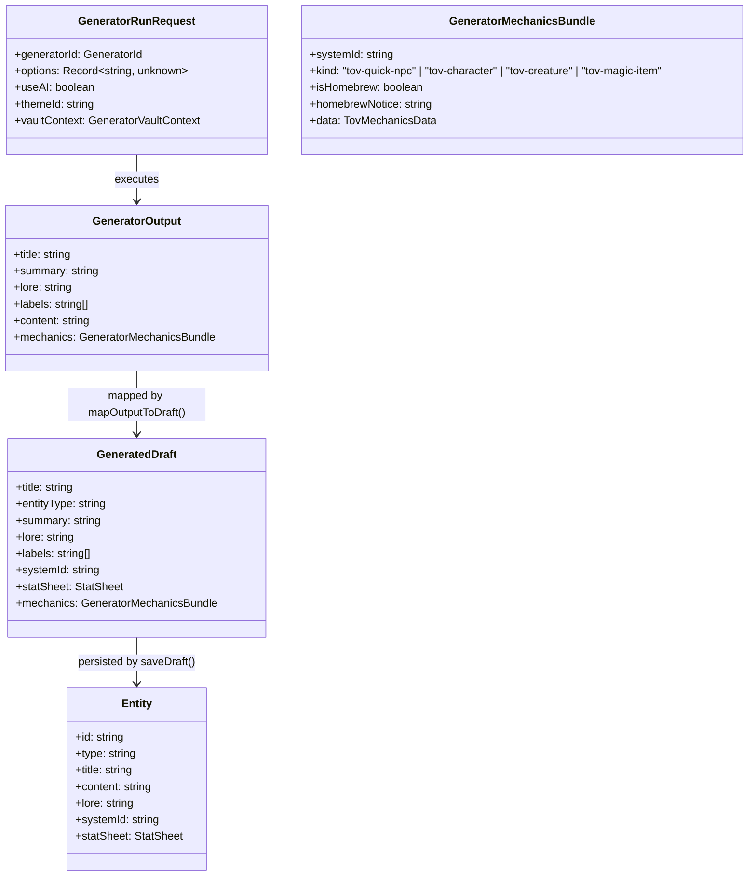

# Data Model & Schema Definitions: ToV Generator Mechanics

**Feature**: [spec.md](./spec.md)  
**Date**: 2026-10-15  
**Status**: Completed

---

## 1. Domain Entities & Type Hierarchy



---

## 2. Structured Mechanics Schemas

All mechanics schemas are strictly validated with Zod in `packages/generator-engine` or `packages/schema`.

### 2.1 ToV Quick NPC Mechanics (`TovQuickNpcMechanics`)

Maps to `builtin-tov-npc`:

```ts
export interface TovQuickNpcMechanics {
  cr: string;
  ac: number;
  hp: number;
  hitDice: string;
  speed: string;
  attackName: string;
  attackBonus: number; // e.g. +4
  attackFormula: string; // e.g. "1d20+4"
  damageFormula: string; // e.g. "1d6+2"
  damageType: string;
  luck: number; // 0-5
  abilityScores: {
    str: number;
    dex: number;
    con: number;
    int: number;
    wis: number;
    cha: number;
  };
  keySaves: string[];
  keySkills: string[];
  notes: string; // concise traits, senses, languages
  isHomebrew?: boolean;
}
```

### 2.2 ToV Leveled Character Mechanics (`TovCharacterMechanics`)

Maps to `builtin-tov-character`:

```ts
export interface TovCharacterMechanics {
  lineage: string;
  heritage: string;
  background: string;
  className: string;
  subclass?: string;
  level: number;
  proficiencyBonus: number;
  ac: number;
  hp: number;
  hitDice: string;
  speed: string;
  luck: number;
  abilityScores: {
    str: number;
    dex: number;
    con: number;
    int: number;
    wis: number;
    cha: number;
  };
  saveProficiencies: Array<"str" | "dex" | "con" | "int" | "wis" | "cha">;
  skillProficiencies: string[];
  attacks: Array<{
    name: string;
    attackFormula: string; // "1d20+5"
    damageFormula: string; // "1d8+3"
    type: string;
    description?: string;
  }>;
  talents: string[];
  features: string[];
  lineageTraits: string[];
  spellSlots?: Record<string, number>;
  isHomebrew?: boolean;
}
```

### 2.3 ToV Creature / Monster Mechanics (`TovCreatureMechanics`)

Maps to `builtin-tov-monster`:

```ts
export interface TovCreatureMechanics {
  size: "Tiny" | "Small" | "Medium" | "Large" | "Huge" | "Gargantuan";
  creatureType: string;
  subtype?: string;
  alignment: string;
  cr: string;
  proficiencyBonus: number;
  doom: number;
  ac: number;
  acDetails?: string;
  hp: number;
  hitDice: string;
  speed: string;
  abilityScores: {
    str: number;
    dex: number;
    con: number;
    int: number;
    wis: number;
    cha: number;
  };
  saveProficiencies: string[];
  skillProficiencies: string[];
  damageVulnerabilities?: string[];
  damageResistances?: string[];
  damageImmunities?: string[];
  conditionImmunities?: string[];
  senses: string;
  languages: string;
  traits: Array<{ name: string; description: string; isHomebrew?: boolean }>;
  actions: Array<{
    name: string;
    attackFormula?: string;
    damageFormula?: string;
    description: string;
    isHomebrew?: boolean;
  }>;
  bonusActions?: Array<{ name: string; description: string }>;
  reactions?: Array<{ name: string; description: string }>;
  legendaryActions?: Array<{ name: string; cost: number; description: string }>;
  isHomebrew?: boolean;
}
```

### 2.4 ToV Magic Item Mechanics (`TovMagicItemMechanics`)

Saved as Markdown content + entity metadata:

```ts
export interface TovMagicItemMechanics {
  rarity:
    "Common" | "Uncommon" | "Rare" | "Very Rare" | "Legendary" | "Artifact";
  category:
    | "Weapon"
    | "Armor"
    | "Shield"
    | "Wondrous Item"
    | "Potion"
    | "Ring"
    | "Rod"
    | "Scroll"
    | "Staff"
    | "Wand";
  attunement: boolean;
  attunementRequirement?: string;
  activationAction:
    "Action" | "Bonus Action" | "Reaction" | "Minute" | "Passive";
  charges?: number;
  rechargeRate?: string; // e.g. "1d4+1 at dawn"
  savingThrowDc?: number;
  rulesText: string;
  isHomebrew?: boolean;
}
```

---

## 3. Stat Sheet Transformation Mapping

`mapTovMechanicsToStatSheet(bundle: GeneratorMechanicsBundle): StatSheet`:

| Source Field        | Template Field ID (`builtin-tov-monster`) | Transformation Rule                                              |
| :------------------ | :---------------------------------------- | :--------------------------------------------------------------- |
| `size`              | `size`                                    | Text string                                                      |
| `creatureType`      | `creature_type`                           | Text string                                                      |
| `cr`                | `cr`                                      | String (e.g. `"3"`, `"1/2"`)                                     |
| `proficiencyBonus`  | `proficiency_bonus`                       | Number                                                           |
| `doom`              | `doom`                                    | Number (counter value)                                           |
| `hp`                | `hp`                                      | Number (counter current & max)                                   |
| `hitDice`           | `hit_dice`                                | String (e.g. `"8d8 + 24"`)                                       |
| `ac`                | `ac`                                      | Number                                                           |
| `abilityScores.str` | `str_score`                               | Number                                                           |
| `abilityScores.str` | `str` (dice)                              | `1d20 + floor((str - 10) / 2)`                                   |
| `saveProficiencies` | `str_save`                                | Adds PB if proficient                                            |
| `actions`           | `actions` (item-table)                    | Rows mapped to name, attack formula, damage formula, description |
| `legendaryActions`  | `legendary_actions`                       | Rows mapped to name, cost, description                           |

For `builtin-tov-npc`:

| Source Field    | Template Field ID (`builtin-tov-npc`) | Transformation Rule                                |
| :-------------- | :------------------------------------ | :------------------------------------------------- |
| `hp`            | `hp`                                  | Counter (current & max)                            |
| `ac`            | `ac`                                  | Number                                             |
| `luck`          | `luck`                                | Counter (0-5)                                      |
| `attackFormula` | `atk`                                 | Dice formula (e.g. `1d20+4`)                       |
| `damageFormula` | `damage`                              | Dice formula (e.g. `1d6+2`)                        |
| `notes`         | `notes`                               | Longtext summarizing senses, traits, and languages |

---

## 4. Entity Markdown Formatting for Magic Items

When saving a ToV magic item, `buildGeneratorSavePayload` formats the `lore` or `content` with a clean markdown section:

```markdown
### Game Statistics (Tales of the Valiant)

- **Rarity**: Rare (Requires Attunement)
- **Category**: Wondrous Item
- **Activation**: Action
- **Charges**: 5 (regains 1d4 + 1 daily at dawn)
- **Save DC**: 15

#### Properties

[Rules text adheres strictly to BFRD terminology]
```
