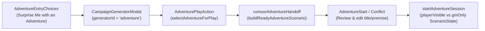

# Mini-Spec: Optional Ready-Made Adventure Start (#4534)

**Status**: Draft  
**Target Area**: `packages/generator-engine`, `apps/web/src/lib/stores/oracle`, `apps/web/src/lib/components/generators`, `apps/web/src/lib/components/oracle/adventure`  
**Tracking Issue**: [#4534](https://github.com/eserlan/Codex-Cryptica/issues/4534)

---

## 1. Specification

### Goal & Problem Statement

Some players want more starting structure than a single rumour hook or a blank premise — they want to say _"Surprise me with an adventure"_ or _"Create a ready-to-play adventure"_ and jump into a prepared scenario with an initial situation, a primary objective, key locations, active pressures, and a hidden GM backstory/cast. Rather than building a separate One-Shot product mode or linear script runner, this feature bridges the existing `adventure` (`Adventure Idea`) generator into the existing Adventure Mode (`ScenarioState` + Oracle GM) with strict player/GM spoiler separation.

### Scope Boundaries

- **In Scope**:
  - **Entry Choice (`AdventureEntryChoices.svelte` / `AdventureSurface.svelte`)**: Add a clear optional start card (**"Surprise Me with an Adventure"** / `data-testid="adventure-surprise-me"`) alongside **Discover an Adventure**, **Create Your Own Premise**, and **Enter Your World**, opening the existing `"adventure"` campaign generator workflow.
  - **Typed Player/GM Adventure Split (`packages/generator-engine/src/adventure-play-selection.ts`)**: Parse a generated `"adventure"` draft (`title`, `summary`, `content`, `lore`) into a validated `SelectedAdventureForPlay` record that separates:
    - `playerVisible`: `title`, `openingSituation` (`## Initial Situation` + optional player-safe hook), `primaryObjective` (`## Primary Objective & Pressure`), and `startingLocations` (`## Key Locations` bullets).
    - `gmOnly`: `truth` (compact synthesis of `## Threats & Antagonists`, `## Clues, Secrets & Discoveries`, and `### Complications & Escalating Pressures`), `ifInvestigated` (compact synthesis of `### Possible Outcomes` and `### Rewards & Stakes`), and `npcsAndFactions` (`## Important NPCs & Factions` bullets).
    - `origin`: `{ kind: "manual", manualId }`.
  - **Generator-to-Adventure Handoff (`AdventurePlayAction.svelte`, `CampaignGeneratorModal.svelte`, `rumour-adventure-handoff.svelte.ts`)**:
    - Shield spoilers in `CampaignGeneratorModal.svelte` when generating/reviewing an `"adventure"` draft from the Adventure route (as well as when `soloSessionStore.isActive`), keeping `content` and `lore` behind the existing `DraftBody.svelte` spoiler shield by default.
    - Render `AdventurePlayAction.svelte` on reviewed `"adventure"` drafts (when `!vault.isGuest`), showing the player-safe opening situation and objective with a **"Play with Oracle"** action.
    - Convert `SelectedAdventureForPlay` into a canonical `ScenarioState` seed (`origin: { kind: "manual" }`, `playerVisible.rumour = openingSituation`, `playerVisible.lead = primaryObjective`, `gmOnly.truth`, `gmOnly.ifInvestigated`, and initial `pressure: { level: 1, maxLevel: 4, summary: primaryObjective }`) via `buildReadyAdventureScenario`.
    - Support round-trip cancellation (`Cancel` in `AdventureStart.svelte` or `AdventureRumourConflict.svelte` restores the generated `"adventure"` draft in `CampaignGeneratorModal.svelte` without losing it) and active-session conflict resolution (`Add to current adventure`, `Continue current adventure`, or `Archive current & start`).
  - **Review & Edit Before Commit (`AdventureStart.svelte` & `AdventureSurface.svelte`)**:
    - Pre-fill the adventure title and player-safe opening premise from the prepared adventure seed while displaying a player-safe **"Prepared adventure seed"** preview (`openingSituation` and `primaryObjective`, never `gmOnly`).
    - Allow the player to review and edit the visible title, premise, and player character before committing, and keep the seed intact if opening generation fails so the user can retry without duplicating a session.
  - **Genre & Secrecy E2E Fixtures**:
    - Verify at least one system-neutral fantasy fixture and one sci-fi/horror fixture through the parser, scenario builder, and `startAdventureSession` / `runAdventureTurn` harness, confirming non-linear player pivots are supported and `gmOnly` secrets/twists never leak into the opening, recaps, suggested actions, or transport.
- **Out of Scope**:
  - A new One-Shot generator algorithm or separate Adventure Library / browser UI.
  - Rules-specific combat encounter builders or mandatory map/dungeon generation.
  - Pre-scripted scene trees that force the player onto linear plot beats.

### User Stories & Acceptance Criteria

- **US-1: "Surprise Me with an Adventure" Entry & Generator Launch**
  - **AC-1.1**: `AdventureEntryChoices.svelte` renders a fourth choice card (`data-testid="adventure-surprise-me"`, heading **"Surprise Me with an Adventure"**) when `onSurpriseMe` is provided; clicking it opens the `"adventure"` generator workflow in `CampaignGeneratorModal.svelte`.
  - **AC-1.2**: When `CampaignGeneratorModal.svelte` is opened on `/(app)/adventure` (or during an active solo session) for `"adventure"`, `spoilerShield` is enabled so `DraftBody.svelte` hides the full plot and GM reference until explicitly revealed.

- **US-2: Typed Player-Safe vs GM-Only Adventure Selection**
  - **AC-2.1**: `selectAdventureForPlay(draft, sourceRecordId?, manualId?)` in `packages/generator-engine` parses Markdown sections from `draft.content` (`## Initial Situation`, `## Primary Objective & Pressure`, `## Key Locations`, `## Important NPCs & Factions`, `## Threats & Antagonists`, `## Clues, Secrets & Discoveries`) and `draft.lore` (`### Complications & Escalating Pressures`, `### Rewards & Stakes`, `### Possible Outcomes`, `### Adventure Hooks`) into `SelectedAdventureForPlay`.
  - **AC-2.2**: `playerVisible` contains only the title, initial situation, primary objective/pressure, and starting location names/leads (bounded to schema limits `<= 600` chars). `gmOnly` holds threats/antagonists, clues/secrets/discoveries, complications, and possible outcomes/rewards (bounded to `<= 600` chars) and is never copied into `playerVisible`.
  - **AC-2.3**: Missing player-visible sections (`## Initial Situation` or `## Primary Objective & Pressure`) or missing GM sections throw a typed `AdventureSelectionError` rather than silently mixing GM text into `playerVisible`.

- **US-3: Review, Edit, Conflict Handling, Cancellation, and Retry**
  - **AC-3.1**: Clicking **"Play with Oracle"** in `AdventurePlayAction.svelte` prepares the handoff (`rumourAdventureHandoff.prepareAdventure(...)`), navigates to `/(app)/adventure`, and closes the generator modal while preserving the draft in memory for cancellation.
  - **AC-3.2**: When no active session exists, `AdventureSurface.svelte` pre-fills `AdventureStart.svelte` with the adventure's `title` and `openingSituation`, displays the player-safe objective preview, and lets the user edit the title/premise or select a character before clicking **Begin adventure**.
  - **AC-3.3**: Clicking **Cancel** in `AdventureStart.svelte` (or `AdventureRumourConflict.svelte`) clears the pending handoff and reopens `CampaignGeneratorModal.svelte` with the same generated `"adventure"` draft restored.
  - **AC-3.4**: If an active adventure session already exists, `AdventureRumourConflict.svelte` lets the user add the prepared scenario to the current adventure, continue the current adventure, archive & start fresh, or cancel.
  - **AC-3.5**: If `onStart` fails (offline, AI Disabled, or network error), the pending seed and edited title/premise remain in `AdventureStart.svelte` so the user can retry without creating duplicate sessions.

- **US-4: Genre Fixtures, Secrecy Guard, and Non-Linear Adaptation**
  - **AC-4.1**: Both a system-neutral fantasy adventure fixture and a sci-fi/horror adventure fixture parse cleanly through `selectAdventureForPlay`, build valid `ScenarioState` seeds (`origin.kind: "manual"`, initial `pressure.level: 1`), and pass `detectHiddenLeakage` and `playerScenarioProjection`.
  - **AC-4.2**: Starting a session from a ready-made adventure seed and taking an unexpected player turn (e.g. abandoning the stated objective to investigate a side detail) adapts cleanly via `runAdventureTurn` while keeping `gmOnly.truth` and `gmOnly.ifInvestigated` out of player-visible messages, recaps, suggestions, and transport.

---

## 2. Technical Plan

### Architectural Approach



1. **Generator Engine (`packages/generator-engine`)**:
   - Create [`packages/generator-engine/src/adventure-play-selection.ts`](file:///home/espen/Projects/Codex-Cryptica/packages/generator-engine/src/adventure-play-selection.ts) and export its public symbols from [`packages/generator-engine/src/index.ts`](file:///home/espen/Projects/Codex-Cryptica/packages/generator-engine/src/index.ts):
     - `AdventureSelectionError` (`"invalid-adventure-draft" | "missing-player-section" | "missing-gm-section"`).
     - `SelectedAdventureForPlay` (validated with Zod):
       ```ts
       export interface SelectedAdventureForPlay {
         origin: {
           kind: "manual";
           sourceRecordId?: string;
           manualId: string;
         };
         playerVisible: {
           title: string;
           openingSituation: string;
           primaryObjective: string;
           startingLocations: string[];
         };
         gmOnly: {
           truth: string;
           ifInvestigated: string;
           npcsAndFactions: string[];
         };
       }
       ```
     - `selectAdventureForPlay(draft, sourceRecordId?, manualId?)`:
       - Extracts `## Initial Situation`, `## Primary Objective & Pressure`, `## Key Locations`, `## Important NPCs & Factions`, `## Threats & Antagonists`, `## Clues, Secrets & Discoveries` from `draft.content` and `### Complications & Escalating Pressures`, `### Rewards & Stakes`, `### Possible Outcomes`, `### Adventure Hooks` from `draft.lore`.
       - Bounds `openingSituation`, `primaryObjective`, `truth`, and `ifInvestigated` to `<= 600` characters (`ScenarioSeed` limit) using clean sentence/clause truncation so long AI-generated sections never fail `ScenarioStateSchema`.

2. **Handoff Store (`apps/web/src/lib/stores/oracle/rumour-adventure-handoff.svelte.ts`)**:
   - Add `buildReadyAdventureScenario(selected: SelectedAdventureForPlay, id: string): ScenarioState`:
     - Maps `selected.playerVisible.openingSituation` -> `playerVisible.rumour`, `selected.playerVisible.primaryObjective` -> `playerVisible.lead`, `selected.gmOnly` -> `gmOnly`, `selected.origin` -> `origin`, and sets initial `pressure: { level: 1, maxLevel: 4, summary: truncate(selected.playerVisible.primaryObjective, 280) }`.
   - Extend `PendingRumourAdventure` / `RumourAdventureHandoff` so a pending handoff can carry an optional `adventureTitle?: string` and `sourceGeneratorId: "rumour" | "adventure"` (via `prepareAdventure(vaultId, selected, scenario, sourceDraft)` or unified `prepare(...)`), while keeping `forVault(vaultId)` backwards-compatible for existing rumour callers and `AdventureRumourConflict.svelte`.

3. **Generator Modal & Play Action (`apps/web/src/lib/components/generators/`)**:
   - Create [`apps/web/src/lib/components/generators/AdventurePlayAction.svelte`](file:///home/espen/Projects/Codex-Cryptica/apps/web/src/lib/components/generators/AdventurePlayAction.svelte):
     - Parses the current `"adventure"` draft with `selectAdventureForPlay(draft)`.
     - Displays the player-safe `openingSituation` and `primaryObjective` (plus location count badge) and a **"Play with Oracle"** button (`data-testid="play-generated-adventure"`), respecting `aiDisabled` and `disabled`.
   - Update [`apps/web/src/lib/components/generators/CampaignGeneratorModal.svelte`](file:///home/espen/Projects/Codex-Cryptica/apps/web/src/lib/components/generators/CampaignGeneratorModal.svelte):
     - Enable `shouldShieldSpoilers` when on `/(app)/adventure` (`page.url.pathname.endsWith("/adventure")`) in addition to `soloSessionStore.isActive`.
     - Restore kept draft from `rumourAdventureHandoff.takeSourceDraft(vaultId)` when `workflow.generatorId === "rumour" || workflow.generatorId === "adventure"`.
     - Render `<AdventurePlayAction />` when `generation.draft.sourceGeneratorId === "adventure" && !vault.isGuest`.

4. **Adventure Entry, Start, and Conflict UI (`apps/web/src/lib/components/oracle/adventure/`)**:
   - Update [`apps/web/src/lib/components/oracle/adventure/AdventureEntryChoices.svelte`](file:///home/espen/Projects/Codex-Cryptica/apps/web/src/lib/components/oracle/adventure/AdventureEntryChoices.svelte):
     - Add optional `onSurpriseMe?: () => void` prop and render the **"Surprise Me with an Adventure"** card (`data-testid="adventure-surprise-me"`) using semantic theme tokens and Iconify icon `icon-[lucide--wand-sparkles]`.
   - Update [`apps/web/src/lib/components/oracle/adventure/AdventureSurface.svelte`](file:///home/espen/Projects/Codex-Cryptica/apps/web/src/lib/components/oracle/adventure/AdventureSurface.svelte) and [`apps/web/src/lib/components/oracle/adventure/AdventureStart.svelte`](file:///home/espen/Projects/Codex-Cryptica/apps/web/src/lib/components/oracle/adventure/AdventureStart.svelte):
     - Pass `onSurpriseMe={() => modalUIStore.openIntentGeneratorWorkflow("adventure")}` from `AdventureSurface.svelte`.
     - When `selectedRumour` was prepared from an `"adventure"` draft (`selectedRumour.adventureTitle`), prefill `startTitle = selectedRumour.adventureTitle` and `startPremise = selectedRumour.selected.playerVisible.rumour`, and reopen `"adventure"` (instead of `"rumour"`) when `cancelRumour()` is invoked.
     - In `AdventureStart.svelte`, label the seed preview **"Prepared adventure seed"** when `scenarioSeed.origin.kind === "manual"` and **"Selected rumour"** when `scenarioSeed.origin.kind === "rumour"`.

### Constitution & Style Guide Compliance

- **Bounded Responsibility (Principle XIV)** & **Fallow Gate**: Keep all new and modified functions/templates under cognitive complexity `<= 15`; put the `"adventure"` play button in a focused `AdventurePlayAction.svelte` component rather than bloating `CampaignGeneratorModal.svelte`.
- **Style Guide & Theme Contrast**: Use Svelte 5 Runes, Tailwind 4 semantic tokens (`text-theme-text`, `text-theme-muted`, `border-theme-border`, `bg-theme-surface` in Adventure components; `chrome-*` tokens in generator modal components), and Iconify utility classes (`icon-[lucide--*]`).
- **Privacy & Spoiler Safety**: `gmOnly` is stripped from all player projections and checked by `detectHiddenLeakage`; `discoveryPolicyStore.aiDisabled` and `vault.isGuest` gates are respected before starting play.

---

## 3. Tasks & Execution Sequence

- [ ] **T1: Adventure Play Selection Parser & Genre Fixtures (`packages/generator-engine`)**
  - **Files**:
    - [`packages/generator-engine/src/adventure-play-selection.ts`](file:///home/espen/Projects/Codex-Cryptica/packages/generator-engine/src/adventure-play-selection.ts) (new)
    - [`packages/generator-engine/src/index.ts`](file:///home/espen/Projects/Codex-Cryptica/packages/generator-engine/src/index.ts)
    - [`packages/generator-engine/tests/adventure-play-selection.test.ts`](file:///home/espen/Projects/Codex-Cryptica/packages/generator-engine/tests/adventure-play-selection.test.ts) (new)
  - **Action**: Write unit tests for `selectAdventureForPlay` covering: (1) a system-neutral fantasy adventure fixture (`generatePublicAdventure` output), (2) a sci-fi/horror adventure fixture, (3) strict exclusion of `## Threats & Antagonists`, `## Clues, Secrets & Discoveries`, `### Complications & Escalating Pressures`, and `### Possible Outcomes` from `playerVisible`, (4) length bounding (`<= 600` chars), and (5) negative tests for missing player or GM sections (`AdventureSelectionError`). Implement `adventure-play-selection.ts` and export from `index.ts`.

- [ ] **T2: Ready-Made Scenario Builder, Handoff Extension & Secrecy/Adaptation Tests (`apps/web/src/lib/stores/oracle/`)**
  - **Files**:
    - [`apps/web/src/lib/stores/oracle/rumour-adventure-handoff.svelte.ts`](file:///home/espen/Projects/Codex-Cryptica/apps/web/src/lib/stores/oracle/rumour-adventure-handoff.svelte.ts)
    - [`apps/web/src/lib/stores/oracle/tests/rumour-adventure-handoff.test.ts`](file:///home/espen/Projects/Codex-Cryptica/apps/web/src/lib/stores/oracle/tests/rumour-adventure-handoff.test.ts)
  - **Action**: Add `buildReadyAdventureScenario(selected, id)` and `prepareAdventure(vaultId, selected, scenario, sourceDraft)` on `RumourAdventureHandoff` (preserving `sourceGeneratorId: "adventure"` and `adventureTitle`). Add unit/integration tests verifying fantasy and sci-fi/horror ready-made seeds through `buildReadyAdventureScenario`, `startAdventureSession`, and `runAdventureTurn` (including an off-script player pivot, `detectHiddenLeakage` checks, and retry/cancel preservation).

- [ ] **T3: Generator Modal Play Action & Spoiler Shield (`apps/web/src/lib/components/generators/`)**
  - **Files**:
    - [`apps/web/src/lib/components/generators/AdventurePlayAction.svelte`](file:///home/espen/Projects/Codex-Cryptica/apps/web/src/lib/components/generators/AdventurePlayAction.svelte) (new)
    - [`apps/web/src/lib/components/generators/AdventurePlayAction.test.ts`](file:///home/espen/Projects/Codex-Cryptica/apps/web/src/lib/components/generators/AdventurePlayAction.test.ts) (new)
    - [`apps/web/src/lib/components/generators/CampaignGeneratorModal.svelte`](file:///home/espen/Projects/Codex-Cryptica/apps/web/src/lib/components/generators/CampaignGeneratorModal.svelte)
  - **Action**: Build and test `AdventurePlayAction.svelte` (rendering player-safe situation/objective, handling `onplay`, `aiDisabled`, and invalid draft fallback) and wire it into `CampaignGeneratorModal.svelte` alongside draft restoration for `"adventure"` and spoiler shielding when opened from `/(app)/adventure`.

- [ ] **T4: Adventure Entry Card, Start Seed Preview & Conflict/Cancel Wiring (`apps/web/src/lib/components/oracle/adventure/`)**
  - **Files**:
    - [`apps/web/src/lib/components/oracle/adventure/AdventureEntryChoices.svelte`](file:///home/espen/Projects/Codex-Cryptica/apps/web/src/lib/components/oracle/adventure/AdventureEntryChoices.svelte)
    - [`apps/web/src/lib/components/oracle/adventure/AdventureStart.svelte`](file:///home/espen/Projects/Codex-Cryptica/apps/web/src/lib/components/oracle/adventure/AdventureStart.svelte)
    - [`apps/web/src/lib/components/oracle/adventure/AdventureSurface.svelte`](file:///home/espen/Projects/Codex-Cryptica/apps/web/src/lib/components/oracle/adventure/AdventureSurface.svelte)
    - [`apps/web/src/lib/components/oracle/adventure/AdventureStart.test.ts`](file:///home/espen/Projects/Codex-Cryptica/apps/web/src/lib/components/oracle/adventure/AdventureStart.test.ts)
  - **Action**: Add **"Surprise Me with an Adventure"** (`data-testid="adventure-surprise-me"`) to `AdventureEntryChoices.svelte`, update `AdventureStart.svelte` to show **"Prepared adventure seed"** when `scenarioSeed.origin.kind === "manual"`, wire `AdventureSurface.svelte` to prefill title/premise and reopen the matching generator (`"adventure"` vs `"rumour"`) on cancel, and add component tests in `AdventureStart.test.ts`.

---

## 4. Verification Gate

- [ ] Changed-file lint passes (`bun scripts/lint-changed.mjs --base origin/staging`)
- [ ] Affected workspace type-check passes (`cd apps/web && bunx svelte-check --tsconfig ./tsconfig.json --threshold error`)
- [ ] Impacted unit & component tests pass (`bun scripts/test-changed.mjs --base origin/staging`)
- [ ] Fallow changed-code audit passes (`bunx fallow audit --changed-since origin/staging`)
